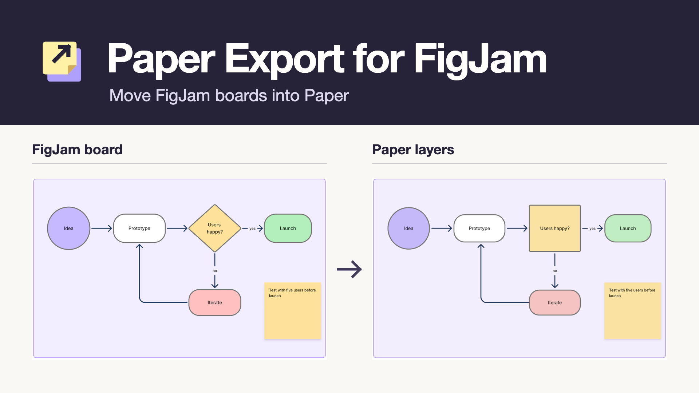

# Paper Export for FigJam

Move a FigJam board into Paper and keep editing its sticky notes, text and shapes. Paper Export for FigJam reads the current page and saves one JSON file. A local Python script turns the export into HTML parts, image files and a placement plan for Paper Desktop.



## Use it

You need Figma Desktop for the development plugin, Python 3.10 or later for the splitter, and Paper Desktop connected to an MCP client for the import. The splitter uses the Python standard library. [Connect an agent to Paper Desktop](https://paper.design/docs/mcp).

### 1. Export the FigJam page

1. Download and unpack the project, or clone it. Keep the project folders together. [Download the source ZIP](https://github.com/Gonzillaaa/paper-export-for-figjam/archive/refs/heads/main.zip).
2. In Figma Desktop, choose **Plugins → Development → Import plugin from manifest** and open `plugin/manifest.json`.
3. Open the FigJam page you want and run **Paper Export for FigJam**. Save `figjam-export.json`. You can also use **Download board JSON** to save another copy or **Copy board JSON** to save it through a text editor.

**Export reference PNGs** downloads a separate `figjam-reference-pngs.json` containing base64-encoded PNGs of the visible sections, keyed by section ID with the colon replaced by a hyphen. Run the splitter on the board JSON. The reference file is for visual comparison.

### 2. Split the export

From the unpacked project directory, run the command below with the path to your saved export. On Windows, use `py -3` in place of `python3`.

```sh
python3 tools/split_export.py "/path/to/figjam-export.json" out/
```

Choose a new or empty output folder. On success it contains:

| Path | Contents |
| --- | --- |
| `out/plan.json` | Artboard names, relative positions, dimensions, appearance and ordered part filenames |
| `out/parts/` | HTML split between top-level layers, in drawing order within each board |
| `out/assets/` | Images referenced by those parts |

The splitter checks HTML balance, layer counts and image references before publishing the output. An empty page yields an empty plan. To retry after a successful run, choose a fresh output folder.

- `--budget N` sets a positive character budget per part. The default is 24,000. A single larger layer stays intact and the CLI prints a warning.
- `--asset-prefix URL` sets the image location. By default the parts point to `out/assets/` using absolute `paper-asset://` paths for Paper Desktop. If you move the output, run the splitter again at the new location.

### 3. Import into Paper

Open the destination file in Paper Desktop and give your connected agent access to the output folder. This prompt uses the same steps as the demo verification.

> Read `out/plan.json`. For each entry create a new artboard with its name, width, height, fill, border (CSS box-shadow) and radius. Size the “Loose page items” artboard to enclose its contents. After creating the boards, use `update_styles` to set their left and top from the plan. For each board, read its files from `out/parts/` in plan order and pass each file’s exact HTML to `write_html` with `mode: "insert-children"`. Insert each part once. Check the resulting artboard positions and dimensions, compare each direct child count with the sum of the part element counts, and take a screenshot of each board.

Paper chooses an open spot when it creates an artboard. The separate positioning step restores the layout relative to the top-left of the export. Some file readers add line numbers, so use one that preserves the HTML.

**Manual alternative (untested).** Paper also accepts pasted inline HTML. For that route, Paper requires publicly reachable image URLs. If those images are intended for public access, supply their location with `--asset-prefix`. [Paper’s HTML import guide](https://paper.design/docs/paste/html).

## Demo

The sample board contains a team retro, a launch diagram and a loose title. On the release check, Paper imported **9 retro layers, 11 flow layers and 1 title**. The two section artboards measured **1180 × 760** and **1240 × 760**. The screenshots below show the sections. The FigJam screenshot hides author labels for comparison.

**FigJam**


**Paper**


To recreate the sample, import `demo/build-board/manifest.json` as a separate development plugin. Run **Paper Export demo board** once on an empty FigJam page. The demo builder adds objects to that page.

## Fidelity and limits

| Source | Paper result |
| --- | --- |
| Sections, frames and groups | Top-level sections become artboards. Nested containers become frames. Loose page items share a separate artboard. |
| Sticky notes | Coloured frames with editable text and shadow. Author labels are omitted. |
| Shapes with text | Editable text inside a frame. Ellipses keep their outline. Other shapes use rectangles or rounded rectangles. |
| Text | Font names, size, weight, colour, alignment, spacing and supported mixed styles. List markers become text. Font availability and wrapping can change the result. |
| Image rectangles | PNG layers rendered from the visible rectangle, including its crop and effects. |
| Connectors, stamps and vectors | SVG layers. Connectors retain their appearance and stay fixed when you move their endpoints. |
| SVG fallback | Embedded bitmaps and SVGs over 60,000 characters become PNG layers at 2× scale. |

The earlier exporter was also exercised on a board with 15 sections, 548 top-level items, 8 images and 73 connectors. For other boards, compare the result with your reference images, especially rotated objects, gradients, masks, overlapping sections, complex text and widgets. Hidden layers, comments, widget interactions and other pages are outside the export.

## Data and permissions

Paper Export for FigJam reads the current page. Its manifest disables network access. The splitter runs locally. The JSON, clipboard and output folder contain the exported board content, including images. The Paper import is a separate step that sends the chosen content to Paper and may also share it with your selected agent.

## Development

The plugin runs as plain JavaScript in Figma, with no build step. `plugin/settings.json` holds the raster scale, reference width, SVG threshold and window size. `tools/settings.json` sets the default part budget.

```sh
node --test
npx --yes oxlint@1.94.0 --deny-warnings plugin/code.js demo/build-board/code.js tests
uv run --locked pytest
uv run --locked ruff check .
```

The JavaScript suite exercises the plugin and UI with Figma and browser boundary fixtures. The Python suite runs the splitter against files, including invalid input, images and concurrent writes.

## Support and license

Report the plugin version or commit, the operation that failed, and the message shown. A minimal synthetic board is enough to demonstrate most issues. [GitHub Issues](https://github.com/Gonzillaaa/paper-export-for-figjam/issues).

The source is available under the [MIT License](LICENSE). Maintainers can find the [Community listing and artwork](docs/community/listing.md) alongside the screenshots.
