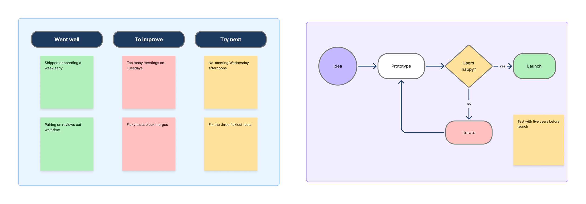

# FigJam to Paper

Move a FigJam board into [Paper](https://paper.design) as editable layers: stickies, shapes with text, text, images, sections, connectors and stamps, each at its original position and size.

## Why this exists

Paper can import from Figma by copy and paste, but its documentation only covers Figma Design files, not FigJam. A FigJam board is mostly stickies, connectors and shapes with text, and none of those have a native route into Paper.

The other obvious route is to read the board through Figma's MCP server and have an AI agent rebuild it. On a large board that means hundreds of calls, and Figma's MCP server is rate limited: in our case the quota ran out before the board was done.

This repo takes a different route. A small Figma plugin reads the whole board inside Figma, where there is no quota, and turns it into HTML in one pass. The rest happens offline.

## Demo

A small board with two sections: a retro made of stickies, and a launch flow made of shapes, connectors and a sticky.

**Before, in FigJam:**



**After, in Paper:** every item is an editable layer at its original position and size.


Two differences are visible: the "Users happy?" diamond arrives as a rectangle, and stickies lose their author label (we also hid the labels in the FigJam picture). Both are listed under [Limits](#limits).

The split step turned this board into this plan (shortened):

```json
{
  "budget": 24000,
  "asset_prefix": "paper-asset:///path/to/out/assets",
  "sections": [
    {
      "id": "6:3",
      "name": "Team retro",
      "left": 0, "top": 140, "width": 1180, "height": 760,
      "fill": "#EBF5FF",
      "border": "inset 0 0 0 2px #85C2FF",
      "radius": 12,
      "parts": [
        { "file": "00-6-3-00.html", "elements": 9, "chars": 4111, "over_budget": false }
      ]
    },
    {
      "id": "6:40",
      "name": "Launch plan",
      "left": 1320, "top": 140, "width": 1240, "height": 760,
      "parts": [
        { "file": "01-6-40-00.html", "elements": 11, "chars": 11853, "over_budget": false }
      ]
    }
  ]
}
```

Items outside any section (here, the board title) go into a last entry named "Loose page items", with no size or fill.

To build the same board yourself, import `demo/build-board/manifest.json` as a development plugin, run it once on an empty FigJam page, then follow the steps below.

## How it works

1. **Export.** The plugin walks every section on the current FigJam page and converts each item to absolutely positioned HTML with inline styles. It downloads one file, `figjam-export.json`, holding each board's HTML and every image.
2. **Split.** `tools/split_export.py` saves the images, cuts each board's HTML into parts small enough to paste (only between top-level items, never inside one), and writes `plan.json` with each board's position, size, colour, border and the order of its parts.
3. **Paste.** An agent with Paper's MCP server (we used Claude Code) creates one artboard per board from the plan and pastes the parts into it in order.

The plugin is read-only: it never changes the FigJam file, and it has no network access (`allowedDomains: none`).

## Use it

You need the Figma desktop app, Python 3.10 or later, and for step 3 an MCP client connected to Paper.

### 1. Export from FigJam

1. In the Figma desktop app: **Plugins > Development > Import plugin from manifest**, then pick `plugin/manifest.json`.
2. Open the FigJam file on the page you want, and run **FigJam to Paper export** from **Plugins > Development**.
3. It downloads `figjam-export.json`. If the download does not appear, press **Copy JSON** and save the clipboard to a file.

**Export reference PNGs** saves a picture of every section (`figjam-reference-pngs.json`, base64 PNGs keyed by section) so you can compare the result in Paper by eye.

### 2. Split

```bash
python3 tools/split_export.py figjam-export.json out/
```

The output folder must be new or empty. The tool checks everything before it writes anything: the HTML of each board must be balanced, its number of top-level items must match the export, and every image it points to must be in the export.

Options:

- `--budget N` sets the maximum characters per part (default 24000, the size we tested). A single item larger than the budget stays whole and is reported as a warning; in our test a 28,554-character part pasted fine.
- `--asset-prefix URL` sets where image `src` values point. The default is `paper-asset://<absolute path to out/assets>`, which Paper's MCP `write_html` reads from local disk.

### 3. Paste into Paper

Open the Paper file and page you want, then give your agent something like this:

> Read `out/plan.json`. For each board, create a Paper artboard with that name, left, top, width, height, background fill, border (it is a CSS box-shadow) and corner radius. Boards without a width are loose items: create an artboard that fits them. Then, for each board in order, read each part file in order and call `write_html` on that artboard with `mode: "insert-children"` and the file contents copied exactly, byte for byte. Never paste a part twice. After each board, check that the artboard's child count equals the sum of `elements` for its parts, then take a screenshot.

Read part files with a tool that returns them unchanged: some file-reading tools add line numbers.

### Without an agent (untested)

Paper also [accepts pasted HTML](https://paper.design/docs/paste/html) with inline styles, which is what the parts contain. We have not tried pasting the parts by hand. If you do, images must be at public URLs for that route: host `out/assets/` somewhere and pass `--asset-prefix https://your-host/assets`.

## What carries over

Tested on one FigJam board: 15 sections, 548 top-level items, 8 images, 73 connectors. All boards landed at their original positions and sizes.

| FigJam | In Paper |
|---|---|
| Sections, frames, groups | Artboards and nested frames |
| Stickies | Coloured frames with shadow and text, scaled to sticky size |
| Shapes with text | Frames with fill, border and centred text; ellipses get a full radius, other shapes become rectangles |
| Text | Text layers with font, size, weight, colour, spacing, alignment and mixed styles |
| Image rectangles | Images (`object-fit: cover`) |
| Connectors, stamps, vectors, lines | SVG |
| Anything with an embedded bitmap, or SVG over 60,000 characters | PNG at 2x |

## Limits

- **Connectors are pictures, not live arrows.** They sit in the right place but do not follow items you move in Paper.
- **Arrow placement.** Figma reports a connector's bounds without its arrowheads, so the plugin sizes each SVG from its own width and height and centres it on those bounds. We checked this on 73 connectors. Other vectors use the same rule; when their sizes already agree it changes nothing, but we have not checked every vector type.
- **Shapes.** Only ellipses keep their outline. Diamonds, triangles and other FigJam shapes arrive as rectangles with the shape's fill, border and text.
- **Fonts** are passed through by name. If Paper does not have a font, it falls back.
- **Not exported:** sticky author labels, comments, widgets' interactive state, hidden items, and anything outside the current page.
- **No automatic comparison.** Use the reference PNGs to check the result by eye.

## Development

```bash
node --test tests/*.test.js     # plugin: arrow placement, style escaping
uv run pytest                   # split tool
```

`plugin/code.js` runs as a plain script in Figma (no build step). It exports its pure helpers when loaded by Node, which is how the tests reach them.

## License

MIT. See [LICENSE](LICENSE).
