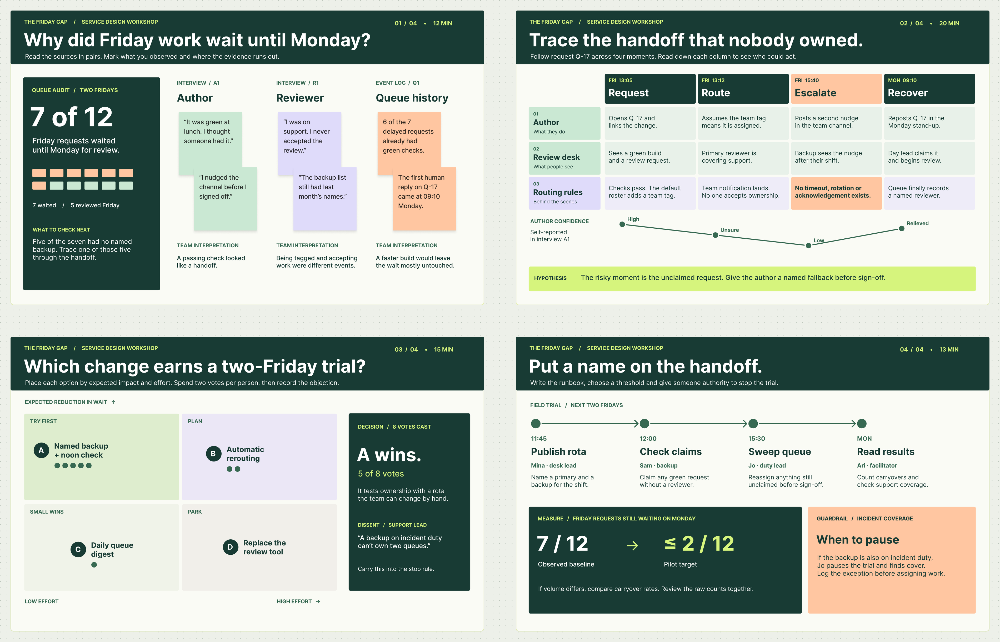
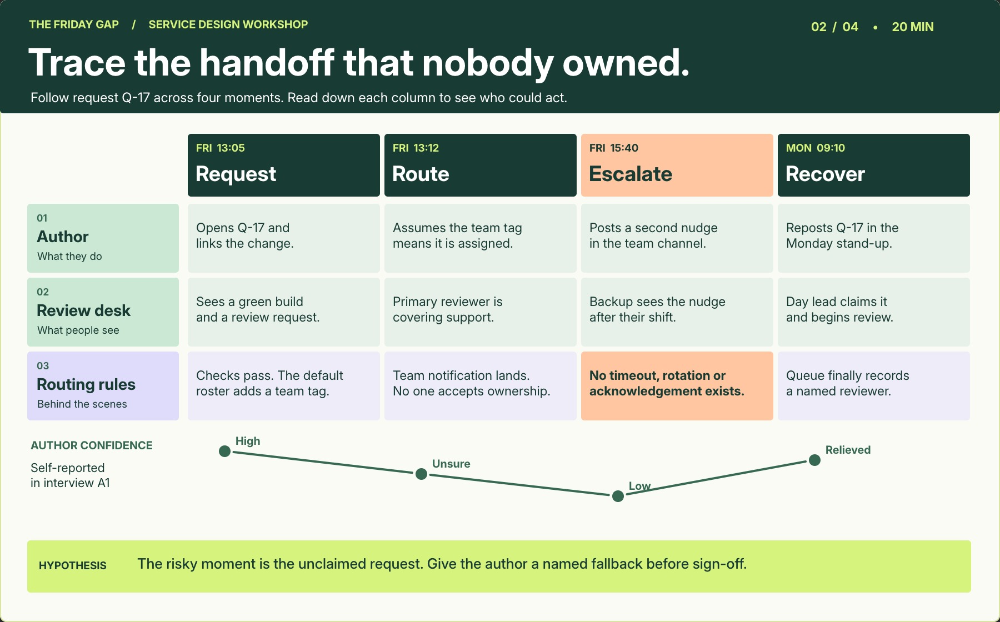
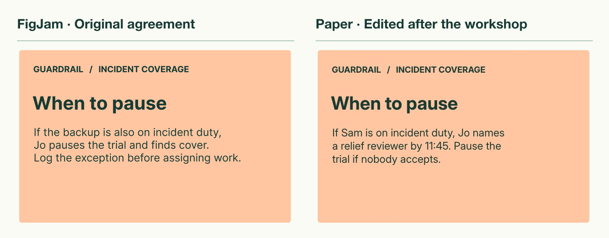

# Paper Export for FigJam

Keep working on your FigJam workshop in Paper. Each section becomes an artboard, with the sticky notes and shapes where your team left them. You can move a note, edit its text and pick up the conversation there.

**The Friday Gap** is a one-hour sample workshop with a question to settle. Seven of twelve Friday review requests were still waiting on Monday. Was the build slow, was the reviewer busy, or did nobody know who owned the handoff? Follow this fictional team from interview notes to a two-Friday field trial.



**Try the sample first.** The project includes the workshop export. From the project folder, run `python3 tools/split_export.py demo/workshop.json sample-out/`, then use the prompt in step 3 with `sample-out/` as your folder. [Sample export](demo/workshop.json)

## Use it

You’ll need the plugin in Figma, Python 3.10 or later, and an agent connected to Paper Desktop. Download and unzip this project to get the splitter. It runs with Python alone. [Download the project ZIP](https://github.com/Gonzillaaa/paper-export-for-figjam/archive/refs/heads/main.zip) · [Connect your agent to Paper](https://paper.design/docs/mcp).

1. **Save your workshop.** Open the FigJam page you want and run **Paper Export for FigJam**. Save `figjam-export.json` beside this README. If the save dialog doesn’t appear, click **Download board JSON**. If you’re installing from source, first choose **Plugins → Development → Import plugin from manifest** in Figma Desktop and select `plugin/manifest.json`.
2. **Prepare the layers.** Open a terminal in the project folder and run the command below. It creates `out/` with your artboard plan, layers and images. Choose a new or empty folder for each export.

   ```sh
   python3 tools/split_export.py figjam-export.json out/
   ```

   On Windows, use `py -3` in place of `python3`.

3. **Bring it into Paper.** Open your destination file in Paper Desktop, give your connected agent access to `out/`, and paste this prompt.

   > Import my workshop from `out/plan.json` onto this Paper page. Create an artboard for each entry using its name, dimensions, fill, shadow and radius. If there’s a board for loose items, size it to fit its contents. After creating each artboard, set its left and top from the plan with `update_styles`. Read its files from `out/parts/` in order and insert each file’s exact HTML once using `write_html` with `insert-children`. Check each board’s position and direct child count against the plan, then show me the result.

## Inside the sample workshop

| Activity | What the team does |
| --- | --- |
| **Evidence wall** · 12 min | Compare the author’s account, the reviewer’s account and the queue history. Six of the seven delayed requests had already passed their checks. |
| **Current-state blueprint** · 20 min | Trace one request from Friday afternoon to Monday morning. Read the author’s actions, the review desk’s response and the routing rules side by side. |
| **Intervention map** · 15 min | Place four options on an impact–effort matrix. Five of eight votes go to a named backup with a noon check. The support lead raises an objection about incident duty. |
| **Pilot agreement** · 13 min | Give each handoff an owner and time. Set a target of at most two carryovers per twelve requests and agree when incident coverage should pause the trial. |

Here’s the blueprint in Paper. At 15:40 the author nudges the team, the backup is already off shift and the routing rules have no timeout. The four points below the lanes trace the author’s confidence through the handoff. [See the same blueprint in FigJam](docs/images/demo-figjam.png)



After import, we edited the pilot agreement in Paper to answer the support lead’s objection. Jo now has an 11:45 deadline to find cover, and the trial pauses if nobody accepts.



To recreate the editable source board, import `demo/build-board/manifest.json` as a development plugin, run **Paper Export demo board** on an empty FigJam page, then export it with the main plugin.

## What comes across

Sticky notes and text stay editable. Sections, groups and frames keep their layout, image rectangles become image layers, and visible items outside sections get their own artboard. Voting dots in this sample are ordinary FigJam shapes.

A few details change. Connectors become fixed graphics, decision diamonds become rectangles, and sticky author labels are omitted. Font availability can affect line breaks. To compare a particular board, use **Export reference PNGs** in the plugin. [Import details, limits and troubleshooting](docs/import.md).

The plugin reads the current page and has no network access. Exported files contain the workshop content. When you import, the chosen content goes to Paper and may also be shared with your agent.

[Report an issue](https://github.com/Gonzillaaa/paper-export-for-figjam/issues) · [Development and checks](docs/import.md#development) · [Listing and artwork](docs/community/listing.md) · [MIT license](LICENSE)
